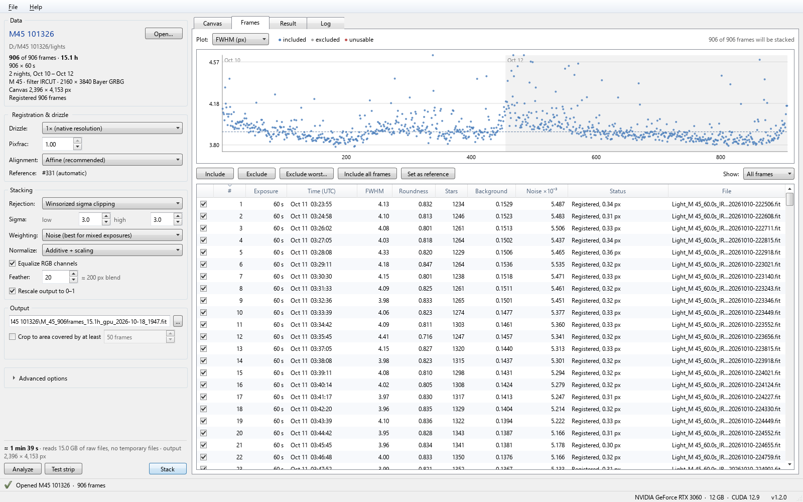
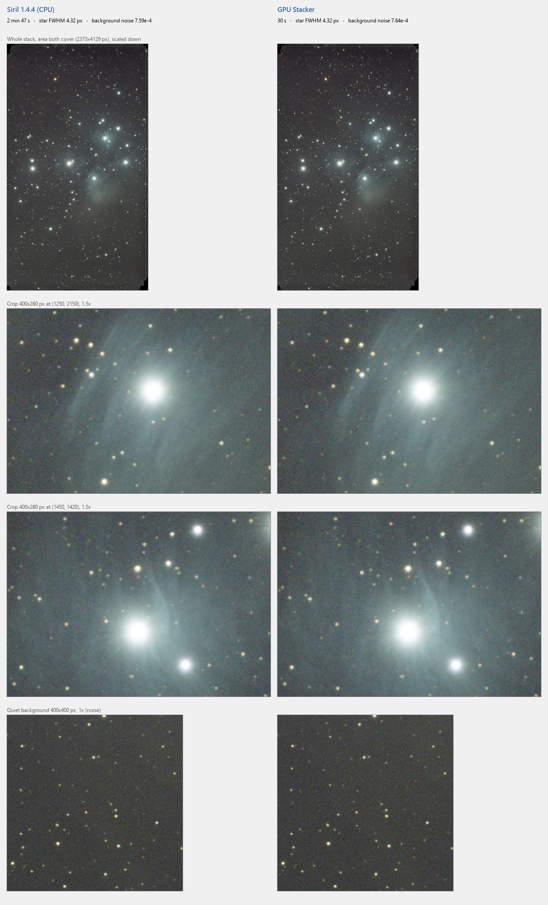
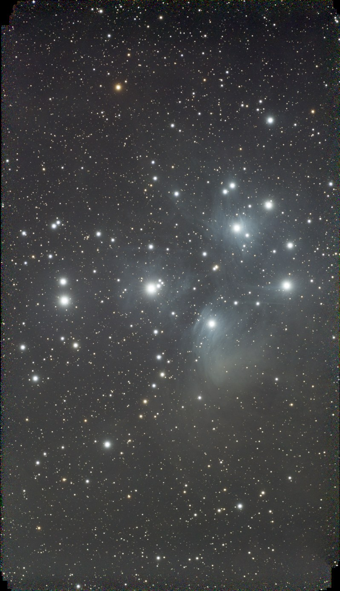

# GPU Stacker

**Fast, free GPU stacking for Seestar subs and Siril sequences, with Siril-quality results.**



GPU Stacker stacks astrophotography subs on an NVIDIA graphics card. Point it at a Seestar `lights`
folder and it finds the stars, registers every sub (mosaics too), Bayer-drizzles them straight from the
camera's colour pattern and stacks them with the same normalization and rejection math as Siril. It also
stacks sequences you registered in Siril, producing the same result as Siril's own stack, and it runs
from Siril's Scripts menu.

> **Public test.** So far GPU Stacker has been tested on an RTX 3060 with Seestar S50 data. Reports from
> other NVIDIA cards, other Seestar models and big datasets are very welcome: please
> [open an issue](../../issues), and attach `%LOCALAPPDATA%\GPU Stacker\gpu-stacker.log` if something
> goes wrong.

## Download

Get `GPU-Stacker-<version>-win64.zip` from the [latest release](../../releases/latest), unzip it anywhere
and double-click **Start GPU Stacker.bat**. There is nothing to install. The first start takes about a
minute longer while the GPU code is prepared.

**You need** Windows 10 or 11 (64-bit) and an NVIDIA graphics card (GTX 10-series or newer) with a
current driver. AMD, Intel and Mac graphics are not supported.

## What it does

- **Raw lights in, stack out.** Star detection, registration (mosaics included), Bayer drizzle from the
  CFA data and stacking, without writing any intermediate files.
- **Siril's stacking math.** Additive + scaling normalization, winsorized or sigma-clipping rejection,
  noise / weighted-FWHM / star-count weighting, feathering and max framing, ported from Siril 1.4.
- **Check before you stack.** FWHM, roundness, star count, background and noise for every sub, one-click
  exclusion of the worst ones, and a quick test strip for trying settings.
- **Siril sequences.** Stacks a registered `r_` sequence with the same result as Siril's `stack` command.
- **Inside Siril.** A Siril script with a small window, or `pyscript GPU-Stacker.py` from your own Siril
  scripts.
- **Portable.** A self-contained zip with its own Python, and a plain, classic Windows interface.

## Speed and quality

| Seestar S50, M45, RTX 3060 | Time |
|---|---|
| 906 subs × 60 s (15.1 h), stacking again with new settings | under a minute |
| The same 906 subs on a first run (star detection, registration, measuring, stacking) | a few minutes |

In a side-by-side test on 100 of these subs, Siril 1.4.4 took 2 min 47 s and GPU Stacker 30 s (an earlier
version; the current one is faster). Both stacks have the same star FWHM (4.32 px), and their background
noise is the same within 1 %:



On a sequence registered in Siril, GPU Stacker's stack matches Siril's own output bit for bit in our tests.

<p align="center">
  <br>
  <sub>M45: 906 × 60 s (15.1 h) with a Seestar S50, stacked by GPU Stacker. Auto-stretched, no other
  processing.</sub>
</p>

## Using it from Siril

1. In Siril, open **Preferences › Scripts**.
2. Under *Scripts Storage Directories*, add the folder `app\siril\GPU Stacker` inside your GPU Stacker
   folder (its full path) on a new line. In GPU Stacker, **File › Add to Siril's Scripts menu** copies
   that path for you.
3. Click the refresh button under the list, then **Apply**.

It then appears as **Scripts › Python Scripts › GPU Stacker › GPU-Stacker.py**. With a registered
sequence loaded it stacks that sequence, with Siril's frame selection; otherwise it stacks the raw lights
next to Siril's working directory. The result opens in Siril. From a Siril script:
`pyscript GPU-Stacker.py r_pp_light` (`pyscript GPU-Stacker.py --help` lists the options).

## Running from source

You need Python 3.11 or newer and an NVIDIA driver.

```bat
git clone https://github.com/JTPrater/GPU-Stacker
cd GPU-Stacker
run.bat
```

`run.bat` creates `.venv`, installs `requirements.txt` and starts the app. Then:

- tests: `.venv\Scripts\python -m pytest` (they need the GPU)
- command line: `.venv\Scripts\python -m gpustacker.engine stack FOLDER_OR_SEQ --out result.fit`
- portable zip: `.venv\Scripts\python tools\build_bundle.py`

## How it works

- **Raw lights.** Stars are found on the 2×2-binned colour data, frames are registered by triangle
  matching (mosaic panels are chained through their neighbours), and each sub's raw rows are drizzled
  onto the canvas on the GPU, one colour at a time, straight from the Bayer pattern.
- **Stacking.** The canvas is stacked in strips. For every pixel, the values from all subs are sorted on
  the GPU, then rejected and averaged with Siril's algorithms. Siril's double-precision sums are
  reproduced exactly (as 64-bit fixed point), so the results match Siril's while running at
  graphics-card speed.
- **Interface.** The window (PySide6) runs the engine (CuPy) in a separate process, so the interface stays
  responsive and the GPU is released when a job ends. Results of the slow steps are cached next to your
  data, so stacking again with other settings is quick.

## License

Copyright (C) 2026 Jason Prater (JP Astrophotography)

GPU Stacker is free software: you can redistribute it and/or modify it under the terms of the
[GNU General Public License](LICENSE), version 3 or (at your option) any later version. It is distributed
WITHOUT ANY WARRANTY. It contains code ported from Siril, RawTherapee, CFITSIO and OpenCV; see
[THIRD-PARTY-NOTICES.txt](THIRD-PARTY-NOTICES.txt).
